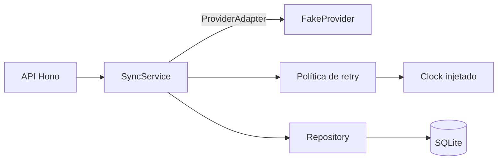

# Métricas das redes do criador

API local para sincronizar métricas de posts de conexões já autorizadas, com provedor simulado, snapshots idempotentes e retry limitado.

**TypeScript · Node.js 24+ · Hono · SQLite · Vitest**

## Arquitetura



O [`SyncService`](src/sync-service.ts) recebe o contrato `ProviderAdapter` por injeção. O [`FakeProvider`](src/provider.ts) simula respostas, erros e timeouts; o [`Repository`](src/repository.ts) cuida da persistência e da unicidade dos snapshots. A política de retry e o relógio ficam em [`retry.ts`](src/retry.ts) e [`clock.ts`](src/clock.ts).

## Execução

Requer Node.js 24 ou superior e npm.

```bash
npm ci
npm run dev
```

A API inicia em `http://localhost:3000` e usa `data/conty.sqlite`.

```bash
npm test
npm run build
npm run demo -- rate-limit
```

As demos usam SQLite em memória. Os cenários disponíveis são `success`, `timeout-recovery`, `transient-recovery` e `rate-limit`. Os dados de exemplo resultam em **20.700 views, 1.370 likes e 114 comentários**, incluindo a deduplicação de um post repetido.

| Variável | Padrão | Descrição |
| --- | --- | --- |
| `PORT` | `3000` | Porta HTTP |
| `DB_PATH` | `data/conty.sqlite` | Caminho do banco |
| `FAKE_PROVIDER_SCENARIO` | `success` | Cenário do provedor simulado |
| `MAX_ATTEMPTS` | `3` | Máximo de tentativas, incluindo a primeira |
| `BASE_DELAY_MS` | `500` | Espera inicial do backoff |
| `MAX_RETRY_DELAY_MS` | `5000` | Teto de espera por retry |
| `REQUEST_TIMEOUT_MS` | `3000` | Timeout de cada busca |

O provedor consome uma fila de respostas. Quando ela se esgota, retorna uma lista vazia; reinicie o servidor para repetir o cenário.

## API

| Método | Rota | Descrição |
| --- | --- | --- |
| `POST` | `/connections` | Cria uma conexão sem devolver o token |
| `POST` | `/connections/:id/sync` | Sincroniza uma janela |
| `GET` | `/connections/:id/posts` | Lista posts, métricas atuais e totais |
| `GET` | `/sync-runs/:id` | Consulta status, tentativas, horários e erro |

Crie uma conexão com token fictício. Plataformas aceitas: `instagram`, `tiktok`, `youtube` e `x`.

```bash
curl -X POST http://localhost:3000/connections \
  -H 'Content-Type: application/json' \
  -d '{"platform":"instagram","externalAccountId":"creator-123","token":"fake-token"}'
```

Substitua `CONNECTION_ID` pelo `connection.id` retornado:

```bash
curl -X POST http://localhost:3000/connections/CONNECTION_ID/sync \
  -H 'Content-Type: application/json' \
  -d '{"windowStart":"2026-09-01T00:00:00.000Z","windowEnd":"2026-11-01T00:00:00.000Z"}'

curl http://localhost:3000/connections/CONNECTION_ID/posts
```

A janela filtra pela publicação do post, com início inclusivo e fim exclusivo. O sync retorna `200` em sucesso, `429` quando o prazo de espera excede o teto e `502` em falha de sincronização.

## Idempotência

Métricas são snapshots de valores absolutos. Repetir uma busca não soma novamente os contadores.

| Entidade | Chave única | Tratamento de repetição |
| --- | --- | --- |
| Post | `connection_id + external_post_id` | Reutiliza o post |
| Snapshot | `post_id + provider_observed_at` | Ignora se os contadores forem iguais |

Para um mesmo post publicado em 25/09:

| Busca | Janela | Snapshot recebido | Views atuais |
| --- | --- | --- | --- |
| Inicial | 01/09 → 01/10 | Observação de 30/09: 10.000 | **10.000** |
| Sobreposta | 20/09 → 01/10 | Mesma observação: 10.000 | **10.000** |
| Atualização | 20/09 → 02/10 | Observação de 01/10: 12.000 | **12.000** |
| Resposta antiga | 01/09 → 01/10 | Observação de 29/09: 9.000 | **12.000** |

Os totais usam apenas o snapshot mais recente de cada post, ordenado por `providerObservedAt`. Observações distintas permanecem no banco. A mesma identidade com contadores diferentes causa rollback e erro `SNAPSHOT_IDENTITY_CONFLICT`.

A gravação usa uma transação `BEGIN IMMEDIATE`. Cada métrica expõe `providerObservedAt`, informado pelo provedor, e `fetchedAt`, registrado pelo serviço ao persistir a resposta validada. Repetições preservam o `fetchedAt` original; os horários de cada execução ficam em `startedAt` e `finishedAt` no `syncRun`.

## Retry e timeout

Timeout, falhas de rede representadas por `TypeError` e respostas `408`, `429`, `500`, `502`, `503` ou `504` permitem retry até `MAX_ATTEMPTS`. Erros permanentes e respostas inválidas encerram o sync sem retry. Uma resposta tardia após timeout não é persistida.

Sem `Retry-After` válido, a espera usa backoff exponencial limitado:

```text
espera = min(BASE_DELAY_MS × 2^(tentativa − 1), MAX_RETRY_DELAY_MS)
Padrão: chamada → 500 ms → chamada → 1.000 ms → última chamada
```

| `Retry-After` em uma resposta 429 | Comportamento, se restarem tentativas |
| --- | --- |
| Segundos inteiros ou HTTP-date válido dentro do teto | Espera o prazo informado e tenta novamente |
| Prazo acima do teto | Encerra com `rate_limited` e informa `retryNotBefore`, sem espera ou retry antecipado |
| Ausente ou inválido | Usa o backoff limitado |
| Número fora do intervalo representável por `Date` | Falha com `RETRY_AFTER_UNREPRESENTABLE` |

São aceitos HTTP-date nos formatos IMF-fixdate, RFC 850 e asctime. Prazo igual ao teto é permitido; datas passadas geram espera zero. Ao esgotar as tentativas, o erro é `RETRIES_EXHAUSTED`. O campo `retryNotBefore` é informativo, sem reagendamento automático.

## Testes

Os testes em [`tests/sync.test.ts`](tests/sync.test.ts) cobrem snapshots repetidos, janelas sobrepostas e concorrentes, observações antigas, `fetchedAt`, timeout, retry limitado e tratamento de `Retry-After`.

O teste de `429` injeta um `FakeClock` e verifica o instante exato da nova chamada:

```text
Retry-After: 3
0 ms       1ª chamada → 429
2.999 ms   Ainda há apenas 1 chamada
3.000 ms   2ª chamada → sucesso
```

O tempo avança com `clock.advanceBy(...)`, sem aguardar três segundos reais. Outros casos verificam HTTP-date e prazos iguais ou superiores ao teto.

A validação registrada anteriormente passou com 24 testes e build concluído. As demos `rate-limit` e `timeout-recovery` retornaram sucesso em duas tentativas. Nesta revisão documental, testes, build e demos não foram executados novamente.

## Limitações

A aplicação usa SQLite síncrono em um único processo. Não há OAuth, acesso a plataformas reais, paginação, filas duráveis ou coordenação de limites entre execuções. Tokens ficam em texto no banco local; use apenas credenciais fictícias.

## Uso de IA e revisão

Usei o Codex para implementar a API, criar os testes e escrever a documentação. Também usei uma segunda sessão do Codex para revisar a implementação.

Minha revisão se concentrou na abordagem da solução, nas decisões de implementação e nos resultados dos testes e das demonstrações. Acompanhei o desenvolvimento e aprovei os ajustes. Não revisei cada linha do código nem executei os testes manualmente; a execução e a revisão técnica foram feitas com o apoio da IA.
